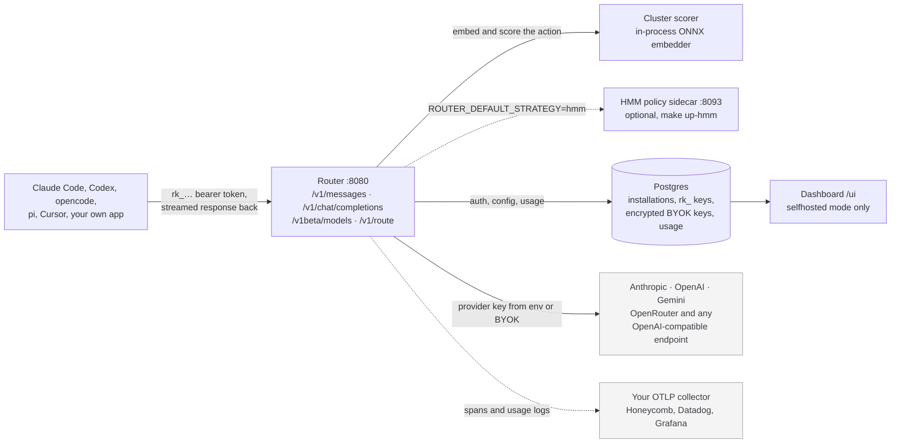

<div align="center">


[](https://app.weaveos.com/reports/repository/org_QWsHDcRQWQEs6RpkdEZrlFK8/https%3A%2F%2Fgithub.com/1222789989)
[](go.mod)
[](https://github.com/weave-os/router/actions/workflows/test.yml)
[](LICENSE)
[](https://github.com/weave-os/router/deployments)
[](https://www.producthunt.com/posts/weave-router-2-0?embed=true&utm_source=badge-top-post-badge&utm_medium=badge&utm_campaign=badge-weave-router-2-0)
</div>

# Weave Router

Weave Router is a proxy that selects a model for each API request. It works with
Anthropic, OpenAI, and Gemini APIs, so you can use it with coding tools or your
own application. You can use the hosted router or run it yourself with your own
provider keys. For the best experience, use the managed router hosted by Weave.

The router uses an embedding and a cluster scorer to choose from enabled models.
It supports streaming, tool calls, and vision. The scorer is based on
[Avengers-Pro](https://arxiv.org/abs/2508.12631).

## Get started

For the hosted router, run the installer and follow the setup prompts:

```bash
npx @weave-os/router
```

You'll need Node 18 or later. The hosted setup page can help you get a router
key; you can also create one in the [Weave dashboard](https://app.weaveos.com/)
under Settings → API keys. To choose a tool directly, use one of these commands:

```bash
npx @weave-os/router --claude
npx @weave-os/router --codex
npx @weave-os/router --copilot
npx @weave-os/router --opencode
npx @weave-os/router --pi
```

The installer configures your selected tool to use Weave. For Copilot, it adds
Weave Router to the model picker; you can also start it with
`copilot --model weave/auto`.

For example, to switch Codex back to its previous provider, run
`npx @weave-os/router off --codex`. Use `on --codex` to switch back to Weave,
or `--uninstall --codex` to remove the configuration. See the [installation guide](install/README.md) for
what changes for each tool, project-level setup, and all available options.

## Run it yourself

You'll need Docker, a provider API key, and a local checkout. For example, with
an OpenRouter key:

```bash
git clone https://github.com/weave-os/router.git
cd router
echo 'OPENROUTER_API_KEY=sk-or-v1-...' >> .env.local
echo 'ROUTER_ADMIN_PASSWORD=replace-with-a-strong-password' >> .env.local
make full-setup
```

This starts the router and Postgres, creates a router key, and offers to set up
Claude Code. The router listens at <http://localhost:8080> and the dashboard is
at <http://localhost:8080/ui/>. The router key (`rk_...`) is printed during
setup; use it to authenticate clients. Your provider key is separate and stays in
`.env.local`. Without an admin password, inference still works but dashboard
administration is disabled.

To connect another supported tool to the local router, add `--local` to its
installer command, for example:

```bash
npx @weave-os/router --codex --local
```

Cursor support is in early beta. In Cursor, open Settings → Models, set
*Override OpenAI Base URL* to `http://localhost:8080/v1`, and enter your
`rk_...` router key.

The self-hosted router sends prompts to your configured provider. It also
supports OpenTelemetry for tracing. For configuration, deployment details, and
other provider options, see the [configuration reference](docs/CONFIGURATION.md).

### Self-hosted HMM

The optional self-hosted HMM is a barebones, frozen version of the policy. It
doesn't include the managed service's training, online learning, or registry.
For the best experience, use the [Weave-managed router](#get-started). The
self-hosted stack defaults to the cluster scorer; starting the HMM sidecar does
not change that default. See the [HMM guide](sidecars/hmm/README.md) for setup
and how to select it.

### Architecture

The router, cluster scorer, database, and dashboard run locally. Requests go
from the router to your configured model provider; you can also send traces to
an OpenTelemetry collector. The optional HMM sidecar uses a compatible embedding
service; its default configuration calls Google's embedding API.



Multi-replica deployments also need Pub/Sub for cache invalidation; Docker
Compose runs an emulator locally.

## API

The router accepts Anthropic Messages (`/v1/messages`), OpenAI Chat Completions
(`/v1/chat/completions`), and Gemini requests (`/v1beta/models/:action`). To
inspect a routing decision without sending a request to a model, use
`POST /v1/route`. The [endpoint reference](docs/ENDPOINTS.md) covers health
checks, response costs, and the other endpoints.

For example, using the local router:

```bash
curl http://localhost:8080/v1/chat/completions \
  -H 'Authorization: Bearer rk_...' \
  -H 'Content-Type: application/json' \
  -d '{"model":"gpt-4o-mini","messages":[{"role":"user","content":"Hi"}]}'
```

See the [configuration reference](docs/CONFIGURATION.md) for router settings,
the [analytics guide](docs/ANALYTICS_EXPORT.md) for exporting routing decisions,
and the [session cost guide](docs/SESSION_COST.md) for usage and savings.

For the rest of the documentation, including routing terminology and policy
integration, see the [documentation index](docs/README.md).

## Contributing

See [CONTRIBUTING.md](CONTRIBUTING.md) for development setup and tests. The
[architecture guide](AGENTS.md) describes the package layout and the
[benchmark guide](bench/README.md) covers the evaluation harness.

## License

[Apache License 2.0](LICENSE). See [NOTICE](NOTICE) and
[THIRD_PARTY.md](THIRD_PARTY.md) for attribution and third-party licenses.
The Apache-2.0 release line begins with `router-v0.2.24`; earlier releases
retain the licenses they shipped with.
