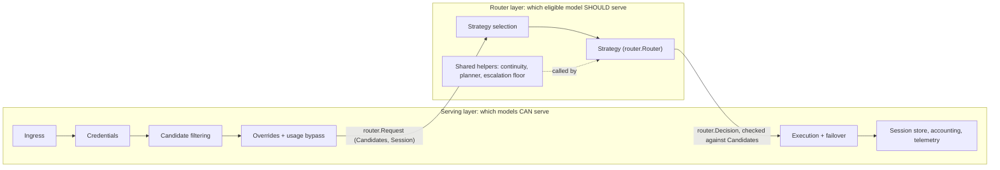

# Router architecture

This page describes how routing is structured on `main` and which check enforces each rule. A failing check names the fix; this page explains why the rule exists.

## Two layers

| Layer | Question it answers | Packages |
|---|---|---|
| **Serving layer** | Which models *can* serve this turn? | Every `internal/` package outside `internal/router` and `internal/routingpolicy`, plus the serving atoms housed there: `internal/router/candidates`, `internal/routingpolicy/overrides`, `internal/router/sessionpin`, `internal/router/handover` |
| **Router layer** | Which eligible model *should* serve it? | The rest of `internal/router/...` and `internal/routingpolicy/...` |

The atomization ratchets scope the serving layer by directory, so they treat every package under `internal/router` and `internal/routingpolicy`, including those four serving atoms, as router layer.

The serving layer owns hard constraints that apply to every strategy: ingress, credentials, candidate filtering, explicit user and client commands (force model, policy pin, utility hard pins), usage bypass, execution and failover, session storage, accounting and telemetry.

The router layer owns the choice among eligible models: classifier calls and calibration, session pin reuse, stickiness, the EV planner, the cost gate, hysteresis, the sliding threshold and escalation.

The serving layer invokes a strategy only through the `router.Router` port, with candidates already filtered, and checks every `router.Decision` it gets back. Inside each layer the inward-only import rules in [`CLAUDE.md`](../CLAUDE.md) still hold, and only `cmd/router` wires concrete adapters.



## Atoms and owners

Each atom has one owner package. New behavior goes in the owner of its concept.

| Atom | Input → output | Layer | Owner |
|---|---|---|---|
| Ingress | HTTP body → turn facts | Serving | `internal/ingress`, `internal/translate` |
| Credentials | request → bindings | Serving | `internal/credentials` |
| Candidate filtering | turn facts + bindings + catalog → `router.Candidates` | Serving | `internal/router/candidates` |
| Overrides + usage bypass | turn facts + candidates + session → resolved, or fall through | Serving | `internal/routingpolicy/overrides` |
| Strategy selection | turn facts + installation config → `router.Strategy` | Router | `internal/router` (`strategy.go`, `strategy_selection.go`), `internal/router/sessionstrategy` |
| Strategy | `router.Request` → `router.Decision` | Router | `internal/router/hmm`, `internal/router/decisionmodel`, `internal/router/policy` (HTTP policy harness) |
| Continuity helpers | session + candidates → reuse, stickiness, cost gate | Router | `internal/router/continuity` |
| Planner | session + classification → stay or switch | Router | `internal/router/planner` |
| Escalation floor | turn facts + session → escalation constraint | Router | `internal/router/escalation`, `internal/router/escalation/floor`, `internal/router/llmescalation` |
| Execution | decision + bindings → served response | Serving | `internal/inference`, `internal/dispatch` |
| Session store | session key → `router.SessionView`; pin write → stored | Serving | `internal/router/sessionpin`, `internal/postgres`; HMM-only pin fields in `internal/router/hmm/pinstate` |
| Handover | model switch → rewritten history | Serving | `internal/router/handover` |
| Accounting + telemetry | served turn + decision → rows and spans | Serving | `internal/billing`, `internal/telemetry` |

Model and provider facts are catalog data in `internal/router/catalog`.

## Strategy contract

A strategy is a `router.Router` registered with a `policy.StrategySpec`:

```go
type Router interface {
    Route(ctx context.Context, req Request) (Decision, error)
}

type StrategySpec struct {
    Strategy     router.Strategy
    Router       router.Router
    Unavailable  error
    Capabilities Capabilities
}
```

- **Input.** `router.Request` carries filtered `Candidates`, a read-only `Session` view and an optional `Escalation` constraint. A strategy doesn't import serving-layer adapters (auth, billing, subscriptions, credentials, dispatch, postgres).
- **Output.** `router.Decision` names the model to serve.
- **Check.** The serving layer runs every decision through `candidates.EnforceMembership` after `credentials.ProductEligibilityRefusal`. A pick outside the offered candidates is replaced by the best eligible fallback, or the turn fails closed.
- **Helpers are opt-in.** A strategy calls the continuity, planner and escalation-floor helpers in the order it needs. A strategy that never calls the planner can't be overridden by it.
- **HMM-only facts stay in HMM.** `internal/proxy` doesn't read HMM-only routing metadata such as classifier confidence, margin, policy group or arm scores; it gets capability flags from `policy.Capabilities`.
- **The upgrade-confidence threshold belongs to `internal/router/hmm`.** Ratcheted: remaining sites outside it are counted in `upgrade_confidence_threshold_references`, and new ones fail CI.
- **Strategy identity.** The serving layer reads the strategy only at its entry points and passes the typed `router.Strategy` down.
- **The serving layer doesn't branch on a named strategy.** Ratcheted: remaining sites are counted in `serving_strategy_constant_references`, and new ones fail CI.
- **Out-of-process strategies** use the HTTP policy harness in `internal/router/policy` ([contract](POLICY_ROUTER_HARNESS.md)). Sidecars return classifier facts; candidate filtering, pins, fallbacks and dispatch stay in Go.

## Enforcement

| Rule | Check |
|---|---|
| Imports flow inward; adapters never import each other | depguard in `.golangci.yml`, `internal/architecture` import tests |
| Serving-layer packages depend on ports, not on `*proxy.Service` | `TestServingLayerDependsOnPortsNotProxy` |
| Only `internal/proxy`, `internal/api`, `internal/server` and `cmd/` import `internal/proxy`. Ratcheted: remaining importers are listed in `proxyImportAllowlist`, and new ones fail CI | `TestOnlyServingLayerImportsProxy` |
| Serving layer doesn't import strategy internals (`internal/router/hmm`, `internal/router/decisionmodel`) | atomization ratchet `serving_strategy_internal_imports` |
| Serving layer calls `Route` only on the checked path, which runs every decision through `candidates.EnforceMembership` | `TestServingLayerChecksStrategyDecisionsAgainstCandidates` |
| Every package that implements `router.Router` or registers a `policy.StrategySpec` is a listed strategy root or a reviewed wrapper | `TestStrategyPackageRootsCoverEveryStrategy` |
| Strategies don't import serving-layer adapters | atomization ratchet `strategy_serving_adapter_imports` |
| Serving layer doesn't branch on named strategies. Ratcheted: remaining sites are counted in `serving_strategy_constant_references`, and new ones fail CI | atomization ratchet `serving_strategy_constant_references` |
| The upgrade-confidence threshold belongs to `internal/router/hmm`. Ratcheted: remaining sites are counted in `upgrade_confidence_threshold_references`, and new ones fail CI | atomization ratchet `upgrade_confidence_threshold_references` |
| Strategy is read only at the listed serving entries | atomization ratchet `strategy_from_context_callers`, `TestStrategyFromContextOnlyAtServingEntries` |
| `internal/proxy` doesn't read HMM-only metadata or branch on reason text | atomization ratchets `proxy_hmm_metadata_references`, `proxy_reason_string_comparisons` |
| `internal/proxy` doesn't sequence router-layer helpers or drive escalation | atomization ratchets `proxy_router_layer_helper_calls`, `proxy_escalation_internal_references` |
| HMM-only pin fields and switch history stay behind the HMM accessor | atomization ratchets `hmm_pin_field_references`, `hmm_history_identifier_references` |
| Environment is read only by entrypoints and `internal/config` | `TestEnvironmentIsReadOnlyByEntrypointsAndConfig` |
| Inference purposes go through the policy boundary | `make inference-boundary` ([inference boundary](INFERENCE_BOUNDARY.md)) |
| Function size and complexity, `Service` fields and methods, context keys, model-name matching and comments never grow | `make arch-ratchet` |
| Architecture baselines and allowlists never grow without a reviewed exception | `make arch-ratchet` (baseline growth guard, `ratchet_exceptions.json`) |
| Routing, credential and accounting decisions are byte-identical across refactors | golden scenarios in `internal/proxy` |
| Semantic leaks no AST test can see | `.weave-checks/router-*.md` LLM checks |

Each atomization ratchet records today's count per package in `internal/architecture/atomization_ratchet_baseline.json` and fails when a count rises or a stale entry stays.
