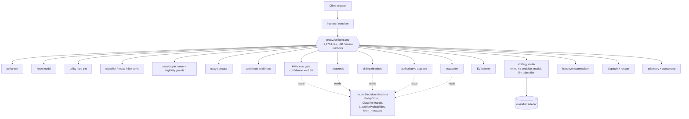
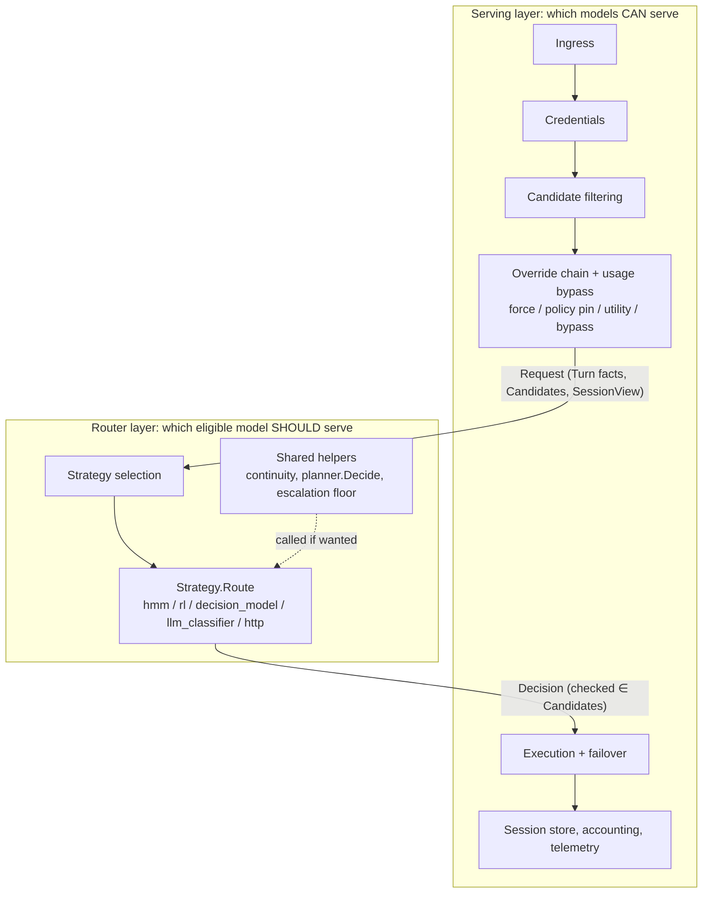
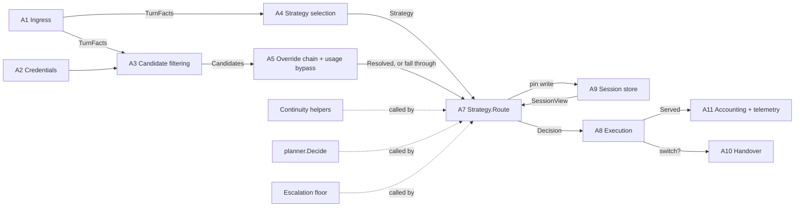
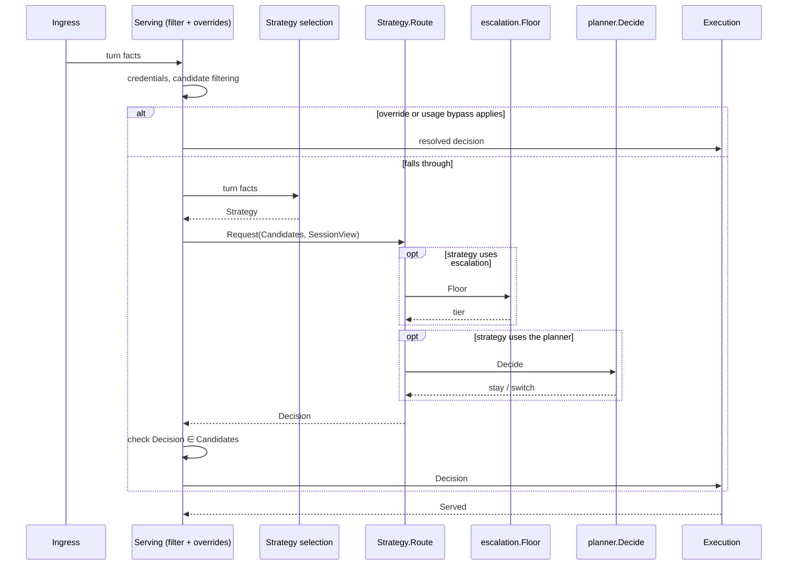
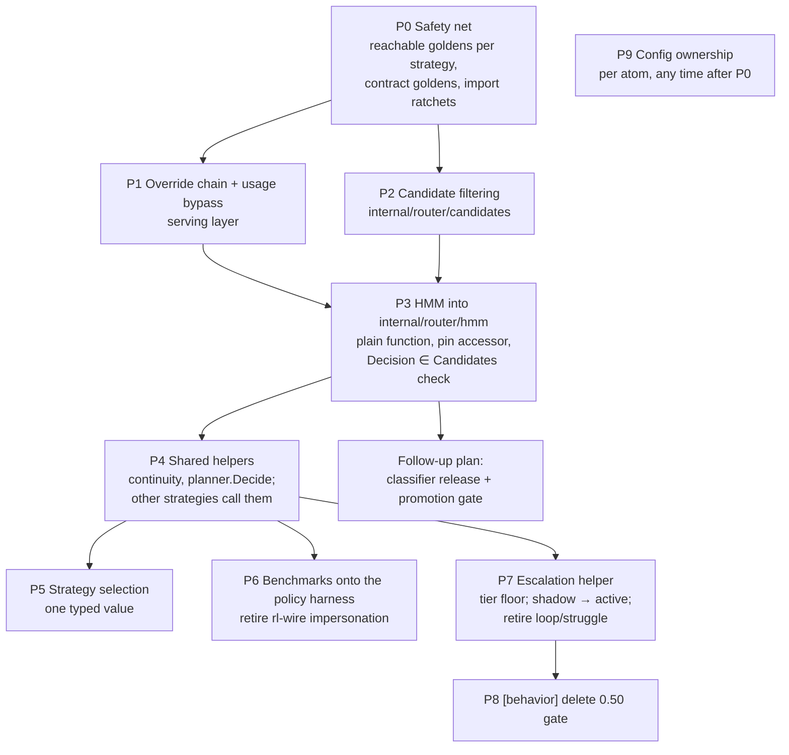

# Router atomization plan

Status: approved migration plan (revision 2).

## 1. Goal

Each part of the router has one typed input, one typed output and one owner package, so it can be changed, fixed or replaced without touching the others. The swappable unit is a **strategy**: the existing `router.Router` port plus `policy.StrategySpec`. A strategy is a plain function that decides which eligible model serves a turn, calling shared pure helpers (continuity, cache economics, escalation) when it wants them. HMM becomes one strategy among several instead of the shape everything else has to imitate.

Decisions this plan is built on:

| # | Decision |
|---|---|
| 1 | Scope is router Go plus the existing [policy harness contract](POLICY_ROUTER_HARNESS.md). Policy sidecars and the downstream benchmark suite consume it. |
| 2 | The unit of swap is the existing **`Strategy`**, evolved in place: `router.Router` + `policy.StrategySpec` + `Service.WithPolicyStrategy`. No new "recipe" type and no rename. `Strategy` stays the term on the wire, in the database, analytics, GraphQL and the UI. |
| 3 | Session behaviour (pin reuse, stickiness, EV planner, HMM cost gate, hysteresis, sliding threshold, authoritative upgrade) is shared **pure functions** a strategy calls, not decorators the orchestrator runs. Anything gated on classifier confidence lives in `internal/router/hmm`. |
| 4 | The 0.50 upgrade-confidence threshold moves into the HMM strategy package now and is deleted once escalation is active. |
| 5 | **Out of scope for now:** the EV planner keeps governing both directions. No downgrade-only change. |
| 6 | Escalation is a shared helper that strategies opt into, shipped shadow then active. Its floor is a catalog tier, mapped from HMM groups in Go. |
| 7 | One strategy port with two adapters: in-process Go and the existing HTTP policy harness (`policy_router_v4`, generic sidecar registration in `cmd/router/policy_sidecars.go`). No new wire. |
| 8 | A strategy sees content-free turn facts, filtered candidates and a read-only session view with a real turn index. The harness request already carries `turn_index`, `visible_turn_index`, `session_turn_count`, `previous_served_model` and `cache_state`. |
| 9 | A strategy returns a model plus a ranked fallback. Nothing outside the HMM package reads confidence, margin or `PolicyGroup`. |
| 10 | Main ships the seam only. Random, step-down and RL stay in the benchmark suite as HTTP policies. |
| 11 | Each atom owns its config struct. Old env names are removed in the same PR that adds the field; there is no alias window (self-hosted is unused). |
| 12 | Structural PRs are move-only behind goldens. Behaviour changes get their own PRs. |
| 13 | Import ratchets stop strategies importing serving-layer adapters and stop proxy branching on HMM-only fields (§6). |
| 14 | Benchmark policies move off the `rl` wire onto the existing policy harness with `authoritative_per_turn_selection`, which already turns off session reuse and planner overrides. |
| 15 | One owner coordinates the full migration. |
| 16 | Two named layers: the **serving layer** decides which models *can* serve; the **router layer** (strategies) decides which eligible model *should* serve (§3.0). |
| 17 | Classifier-release work (strategy `Requires`, promotion compatibility gate, calibration in variant config, escalation models as classifier-release variants, per-variant runtime bindings) is a **separate follow-up plan** (§5). No new promoted component, here or there. |
| 18 | HMM-private session state stays in typed `router.session_pins` columns behind an HMM-owned accessor. No opaque state blob and no session-table migration. |

Non-goals: changing credential rules, accounting, provider dispatch, failover, translation or streaming. These already sit in their own bounded contexts (`credentials`, `billing`, `inference`/`dispatch`, `translate`, `sse`) and stay byte-identical.

### 1.1 What changed after review

Review found the first draft built a second plug-in seam beside one that already exists and added abstractions the code doesn't fit. Every change below removes work:

| Dropped from draft 1 | Why | Replaced by |
|---|---|---|
| New `recipe` package, `Recipe`/`Policy`/`Proposal` types | Duplicates `router.Router`, `StrategySpec`, `Capabilities`; "recipe" already means a benchmark experiment and "policy" has ~5 meanings | Evolve `StrategySpec` in place |
| `Control.Apply` chain and `CandidateNarrower` | Stickiness and usage bypass return *before* the classifier; the cost gate wraps the planner; HMM controls need margin. A post-proposal decorator can't express that move-only | Strategy is a plain function calling shared pure helpers in the order it needs |
| New "policy wire v1" | `policy_router_v4` already carries turn index, session turn count, previous served model and cache state | Benchmarks move onto the existing harness |
| Opaque `recipe_state` blob and the session-state split phase | HMM is the only in-process stateful strategy (3 fields); the pin upsert merges them atomically in SQL; a blob breaks that and hides fields from downstream SQLC readers | Typed columns behind an HMM-owned accessor |
| Rename to "recipe" and its data migration + downstream GraphQL/UI PRs | Existed only to support the rename | Keep `Strategy` everywhere |
| `routingpolicy/recipes/<name>` packages | Second home beside `internal/router/{hmm,rl,decisionmodel}` | Extract into the existing strategy packages |
| Classifier-release phases inside this plan | Release format and promotion gate are the historical failure mode; too much for one plan | Separate follow-up plan (§5) |
| Contracts-only phase with no callers | Ports without callers | Folded into the HMM extraction |
| 200-line orchestrator ratchet and 9 scenarios per strategy | Rewards shuffling code; many scenarios are unreachable for some strategies | Import ratchets and only reachable scenarios |
| Usage bypass under shared continuity | It decides whether a turn is routed and billed at all, and imports `auth`, `billing`, `subscriptions` | Serving layer, next to the override chain |

## 2. Where we are

### 2.1 Today's turn



Everything goes through one function. Precedence is the order of `if` blocks. Each control reads whatever it needs from `router.Decision.Metadata`, a 30-field struct shaped around HMM.

### 2.2 Coupling inventory

| Coupling | Measured today |
|---|---|
| Orchestrator size | `runTurnLoop` at `turnloop.go:480-1749`. `proxy` has 449 `Service` methods, a ~128-line `Service` struct, 32k production lines and 47 internal imports. |
| HMM-only fields read in `internal/proxy` (non-test) | `StrategyFromContext` 32, `PolicyGroup` 23, `Reason ==` 21, `ClassifierProbabilities` 14, `IsHMMStrategy` 8, `ArmScores` 7, `ClassifierMargin` 5. |
| Confidence calibration | `DefaultHMMUpgradeConfidenceThreshold = 0.50`, consumed in `routingpolicy/hmm_cost_gate.go`, `routingpolicy/authoritative_guards.go`, `proxy/authoritative_upgrade.go`, `proxy/service.go` and `proxy/turnloop.go`. |
| Strategy identity spread | `router.Strategy` (7 values), `router.RoutingModel` (5), `IsHMMStrategy`/`IsBetaStrategy`, and `isHMMDecision` falling back to `strings.HasPrefix(reason, "hmm_policy")`. |
| Session state | `sessionpin.Pin` has 33 fields mixing generic continuity (model, provider, turns, cache tokens) with HMM-only state (votes, strikes, policy group). `router.session_pins` has been altered by 21 migrations. |
| Experiments | Benchmark policies impersonate the `rl` wire and must set `ROUTER_SESSION_PIN_ENABLED=false` and `ROUTER_PLANNER_ENABLED=false`. `rl.go:60` hard-codes `TurnIndex: 0`, so step-down rebuilds call depth from history. |
| Escalation | Four mechanisms, not two. (1) XGB per-turn scorer in `router-hmm-sidecar` (`/escalation/observe` via `SidecarRouter`), with Terraform passing an artifact pin through the environment. (2) HTTP external scorer (`internal/escalationscorer`, `ROUTER_HTTP_ESCALATION_*`, `/escalation/score` + `/escalation/readyz`), plus `switchyard_llm_v1`. (3) Hosted Qwen LLM judge, pinned and deployed separately, reached through `ROUTER_LLM_ESCALATION_URL`. (4) Non-LLM loop and struggle escalation (`loop_escalation_events`, `struggle_escalation_events`, spiral shadows). None of it is in the serving registry. The floor is an HMM group (`low` through `maximum`), stored in `router.llm_escalation_sessions.state->>'floor'` and `router.escalation_sessions`, and the sliding threshold compares it to `PolicyGroup`. |
| Routing metadata | `RoutingMetadata` has about 52 fields. About 20 non-HMM fields have no owner, and dispatch reads `SelectedArmID`, `SelectedUpstreamID` and `BindingIndex` (`dispatch/bindings_for_dispatch.go`). |
| Config surface | 146 `ROUTER_*` env names in `cmd/router` and `internal/config`, direct `os.Getenv` calls outside `cmd/`, ~60 flags, and downstream org flag overrides (`escalation_xgb_*`, `loop_escalation_*`, `struggle_*`). |
| Cross-repo readers | Downstream consumers read router tables directly (SQLC compiles against router migrations), parse `decision_reason` text for HMM groups, ingest OTel `routing.*` span attributes, and use strategies and HMM clusters in the admin portal and customer model selector. See §10. |
| Cost of adding a strategy | The opt-in random mode (#2249) touched 79 files (+2,484 lines) and was reverted (#2284). |

## 3. Target architecture

### 3.0 Two layers: serving and router

- **Serving layer: which models CAN serve.** Hard constraints that apply to every strategy: ingress, credentials, candidate filtering (eligibility), usage bypass, explicit user/client commands, execution and failover, session storage, accounting and telemetry.
- **Router layer: which eligible model SHOULD serve.** One strategy per turn, plus the shared helpers it chooses to call.
- The serving layer calls the router through the existing `router.Router.Route` port, with candidates already filtered. It gets back a `Decision`, which it checks: the selected model must be one of the offered candidates (the policy harness already enforces this for sidecars; P3 makes it uniform).
- Clean Architecture still holds inside each layer: both depend on inner-ring types and ports, and only `cmd/router` wires concrete adapters.



| Serving layer: CAN serve (applies to every strategy) | Router layer: SHOULD serve (owned by the strategy) |
|---|---|
| Credentials, request compatibility, provider/model eligibility, exclusions, context window, image capability | Classifier calls and calibration |
| Usage bypass (subscription pass-through: whether the turn is routed and billed at all) | Session pin reuse, tool-result stickiness |
| Explicit user/client commands: `/force-model`, policy pin, utility hard pins | EV planner, HMM cost gate, hysteresis, sliding threshold, authoritative upgrade |
| Fallback/failover when the pick can't be served | Escalation |
| Product-wide constraints ("every turn gets at least tier X"), expressed as eligibility or roster | |

### 3.1 Atoms



| Atom | Input → output | Layer | Package (target) | Status |
|---|---|---|---|---|
| A1 Ingress | HTTP body → turn facts | Serving | `internal/ingress`, `internal/translate` | Exists |
| A2 Credentials | request → bindings | Serving | `internal/credentials` | Exists, untouched |
| A3 Candidate filtering | turn facts + bindings + catalog → candidates + per-candidate reasons | Serving | new `internal/router/candidates` (not `eligibility`, which already models product source boundaries) | Extract from `proxy` (P2) |
| A4 Strategy selection | turn facts + installation config → `Strategy` | Router | `internal/router/strategy.go`, `routing_model.go`, `sessionstrategy` | Exists; one typed value instead of two context keys (P5) |
| A5 Override chain + usage bypass | turn facts + candidates + session → resolved or fall through | Serving | new `internal/routingpolicy/overrides`, reconciled with `PolicySpec.OverridePrecedence` | Extract from `proxy` (P1) |
| A6 Escalation floor | turn facts + session → catalog tier (or none) | Router helper | `internal/router/escalation` | Exists; floor becomes a tier (P7) |
| A7 Strategy | `Request` → `Decision` | Router | existing `internal/router/{hmm,rl,decisionmodel}`, `policy` (HTTP harness) | Exists; HMM logic moves in from `proxy` (P3) |
| A8 Execution | decision + bindings → served | Serving | `internal/inference`, `internal/dispatch` | Exists, untouched |
| A9 Session store | key → `SessionView`; pin write → stored | Serving | `internal/router/sessionpin` + `internal/postgres` | Exists; HMM-only fields behind an accessor in `hmm` (P3) |
| A10 Handover | switch event → history | Serving | `internal/router/handover` | Exists, untouched |
| A11 Accounting + telemetry | served + decision → rows | Serving | `internal/billing`, `internal/telemetry` | Exists, untouched |

Unplaced packages get a layer in P4: `switchpolicy`, `bandswap`, `percallband` (cache-economics helpers), `taskarm`, `taskdomain` (classifier inputs, router layer).

### 3.2 The strategy contract (sketch)

No new port. `router.Router` stays the interface and `policy.StrategySpec` stays the registration, including `OutcomeReporter` and `FeedbackReporter`:

```go
type Router interface {
    Route(ctx context.Context, req Request) (Decision, error)
}
```

What changes is what the serving layer puts in `Request` and what may read `Decision`:

- `Request` gains typed `Candidates` (already filtered) and a read-only `SessionView` (turn index, last served model/provider, cache state). Most of this already exists as loose fields; P3 groups it.
- `Decision.RoutingMetadata` keeps its fields so telemetry and analytics stay byte-identical, but only `internal/router/hmm` may read the HMM-only ones (`PolicyGroup`, `Classifier*`, `ArmScores`, `SelectionTrace`). Dispatch keeps reading `SelectedArmID`, `SelectedUpstreamID`, `BindingIndex`.
- The serving layer checks `Decision` ∈ `Candidates` for every strategy and fails closed.

The HMM strategy becomes a plain function that calls helpers in the order it needs (illustrative):

```go
func (s *Strategy) Route(ctx context.Context, req router.Request) (router.Decision, error) {
    if d, ok := continuity.Reuse(req.Session, req.Candidates); ok {
        return d, nil
    }
    if d, ok := continuity.ToolResultSticky(req.Turn, req.Session); ok {
        return d, nil
    }
    candidates := req.Candidates
    if s.escalation != nil {
        candidates = escalation.AtLeast(candidates, s.escalation.Floor(ctx, req))
    }
    fresh, err := s.classify(ctx, req, candidates)
    if err != nil {
        return router.Decision{}, err
    }
    state := s.pins.Load(req.Session)
    return s.costGate(planner.Decide(s.planner, req.Session, fresh), fresh, state), nil
}
```

A random or step-down strategy is the same shape with none of those calls; it can't be overridden by a planner it never invoked.

| Strategy | Classifier | Continuity | Planner | Escalation | Where |
|---|---|---|---|---|---|
| `hmm`, `hmm_embedding`, `hmm_beta`, `hmm_qwen` | HMM sidecar | yes | yes (+ cost gate, hysteresis, sliding threshold) | yes | `internal/router/hmm` |
| `rl` | none | as today (P0 golden) | as today | no | `internal/router/rl` |
| `decision_model`, `llm_classifier` | their own | as today | as today | no | `internal/router/decisionmodel`, `policy` |
| HTTP policy (benchmarks: random, step-down, RL) | sidecar-owned | off (`authoritative_per_turn_selection`) | off | no | `policy` harness + downstream benchmark suite |

### 3.3 One turn, after



### 3.4 Session state

- `router.session_pins` keeps its typed columns and its atomic SQL upsert (`db/queries/session_pins.sql`).
- Generic fields (model, provider, turns, cache tokens, timestamps, error counters) form the `SessionView` every strategy can read.
- HMM-only fields (`policy_group`, `consecutive_downgrade_votes`, `consecutive_upgrade_votes`) are read and written only through an accessor in `internal/router/hmm`. A ratchet enforces it.
- No migration, no blob, no change for downstream SQLC readers. Sessions keep the existing activation-retention rule.

## 4. Configuration

- Each atom has a `Config` struct; `cmd/router` maps env and flags into it. Atoms never read env.
- Strategy definitions are Go code. No strategy manifest artifact.
- Old env names are removed in the same PR that adds the config field (decision 11). The benchmark suite maps old names for older router commits it still pins.
- Benchmarks configure HTTP policies through the existing sidecar registration, not by flipping `ROUTER_SESSION_PIN_ENABLED` / `ROUTER_PLANNER_ENABLED`.

## 5. Promotion and the follow-up classifier plan

This plan changes no promotion. Code, classifier and roster stay the only three promoted components.

The classifier-release work agreed earlier moves to a **separate follow-up plan**, started after P3 here. Its agreed principles:

- A strategy names the classifier variants it uses by stable name (`primary`, `qwen`, `escalation_scorer`, `escalation_judge`), never by hash.
- Each strategy declares `Requires` (variants, classifier API major, taxonomy, calibration keys). The existing serving apply step rejects a code or classifier proposal that breaks one, before the CAS. No fourth promotion.
- A classifier promotion must leave untouched variants byte-identical.
- Calibration (`upgrade_confidence_threshold`, `downgrade_hysteresis_turns`) moves into the variant configuration, with a benchmark-only override.
- Escalation models become classifier-release variants using the existing per-variant runtime binding mechanism, retiring both escalation pin sets, the standalone judge deployment workflow, `ROUTER_LLM_ESCALATION_URL` and its secret. The Qwen judge prompt and schema stay in Go.
- Related touch points include v4 selection, `internal/servingvalidate`, escalation releases, HMM deployment and downstream savings reporting.

## 6. Enforcement

Each ratchet starts at today's count, only goes down, and is proven by a synthetic violation in P0.

| Ratchet | Today | Target |
|---|---|---|
| `internal/proxy` reads of `Metadata.{PolicyGroup,Classifier*,ArmScores,SelectionTrace}` and `IsHMMStrategy` | 23 + 14 + 7 + 5 + 8 (+ `SelectionTrace`) | 0 outside `internal/router/hmm` |
| `StrategyFromContext` callers | 32 | only strategy selection and the serving-layer entry |
| Reason-string comparisons (`Reason ==`, `hmm_policy` prefix) in `internal/proxy` | 21 | 0 |
| Strategy packages importing serving-layer adapters (`auth`, `billing`, `subscriptions`, `credentials`, `providers/*`, `dispatch`, `postgres`) | n/a | 0 |
| Serving-layer packages importing strategy internals (anything but `router.Router`, `Request`, `Decision`) | n/a | 0 |
| HMM-only pin fields read outside the `hmm` accessor | n/a | 0 |
| New `decision_reason` parsing in downstream consumers | 2 sites | no new sites |

## 7. Migration

Every phase is one or more PRs. Structural PRs are move-only: goldens and credential/accounting goldens stay byte-identical, with no golden edits in the same PR. Behaviour changes are tagged **[behavior]**, go in their own PR and need benchmark evidence. Each PR that moves `planner/policy.go`, `sessionpin/store.go`, `policy/resolver.go`, `cluster/scorer.go` or `catalog/catalog.go` updates the benchmark suite's Go parity extraction list in a paired downstream PR.



### P0 — Safety net

- Golden scenario per precedence rule in [the proxy turn loop](PROXY_TURN_LOOP.md) (policy pin, force, utility hard pin, classifier/recap/title turns, pin reuse, usage bypass, stickiness, planner), using the `golden-traces` skill.
- Per-strategy goldens only for scenarios that strategy can reach (HMM: first turn, sticky reuse, confident upgrade, low-confidence upgrade kept, downgrade with hysteresis, planner stay/switch, deadline fallback; others: first turn, reuse, planner if reachable).
- A golden recording what pins and the planner do today to a non-HMM decision, which P4 must preserve.
- Contract goldens for downstream consumers: the `model_router_request_telemetry` column set and vocabularies (`strategy`, `decision_reason`, `planner_outcome`, `pin_tier`, `sticky_hit`), `/v1/analytics` fields, `routing.*` OTel span attributes read by trace ingestion, and the `hmm_policy(group=…)` reason text they parse. Also pin the metrics pipeline's router-decision vs forced classification.
- The §6 ratchets at today's baselines, each failing on a synthetic violation.

### P1 — Override chain and usage bypass (serving layer)

- Move policy pin, user force, utility hard pin, classifier/recap/title handling and usage bypass (`proxy/usage_bypass.go`) into `internal/routingpolicy/overrides` as an ordered list of resolvers returning `(Decision, handled)`, ordered by the existing `PolicySpec.OverridePrecedence` instead of a second precedence list.
- Covers the routing-knob headers (`x-weave-routing-*`, `EffectiveKnobsHash`), force-model aliases and exclusions, `x-weave-allowed-models`. `x-weave-flag-overrides` keeps working.
- `runTurnLoop` calls the chain once. Move-only.

### P2 — Candidate filtering (serving layer)

- Move `pinEligible`, `automaticPinEligible`, `forcedPinEligible`, `withAutomaticExclusions`, strike merging, context-window checks and output-cap saturation into `internal/router/candidates`, returning candidates plus per-candidate reasons for telemetry.
- `/v1/router/models`, `/v1/router/models/:model/prepare`, `excluded_providers.go`, BYOK aliases and entitlement-gated routing models (`ExperimentalRoutingModelsPermitted`, `AdmitRoutingModel`, `direct_admission.go`) read from here.
- Move-only; lands in parallel with P1.

### P3 — HMM into `internal/router/hmm`

- Move the cost gate (`routingpolicy/hmm_cost_gate.go`, `proxy/hmm_cost_gate.go`), hysteresis, sliding threshold and authoritative upgrade (`proxy/authoritative_upgrade.go`, `routingpolicy/authoritative_guards.go`) into the existing `internal/router/hmm` package, called from the HMM strategy's `Route` as in §3.2.
- `DefaultHMMUpgradeConfidenceThreshold`, `DefaultHMMDowngradeHysteresisTurns`, the `hmm_*` reason constants and the group ↔ `catalog.Tier` map move with them.
- Add the HMM pin accessor over the existing typed columns (§3.4); the SQL upsert is unchanged.
- Group the loose `Request` fields into `Candidates` + `SessionView`, and add the serving-layer `Decision ∈ Candidates` check for in-process strategies (sidecars already have it).
- Delete `isHMMDecision` and its `hmm_policy` prefix check.
- Reason strings and `Strategy` names stay byte-identical; `selection_trace` stays as an HMM-only column.
- 3–4 PRs, one per moved piece. Done when the proxy HMM-field ratchet is 0 and goldens are unchanged.

### P4 — Shared helpers and the other strategies

- `continuity` helpers (pin reuse, tool-result stickiness) and the existing pure `planner.Decide`, reading only `SessionView`. **No planner direction change (decision 5).**
- `rl`, `decision_model` and `llm_classifier` call exactly the helpers that reproduce their P0 goldens.
- Assign `switchpolicy`, `bandswap`, `percallband`, `taskarm`, `taskdomain` to a layer and owner package.

### P5 — Strategy selection

- Resolve routing-model name, `/beta` opt-in, `x-weave-router-strategy`, `x-weave-policy-pin`, `x-weave-force-cluster`, installation `routing_strategy` and the stored session preference (`sessionstrategy`) into one typed `Strategy` value, instead of the separate `Strategy` and `RoutingModel` context keys.
- Internal only: names, headers, tables, analytics values and GraphQL don't change, so there is no data migration or downstream PR.
- Done when the `StrategyFromContext` ratchet reaches its target.

### P6 — Benchmarks onto the existing policy harness

- Benchmark policies (random, step-down, RL) register as HTTP policies through `cmd/router/policy_sidecars.go` with `authoritative_per_turn_selection`, instead of impersonating the `rl` wire and flipping `ROUTER_SESSION_PIN_ENABLED` / `ROUTER_PLANNER_ENABLED`.
- They read the harness's `turn_index`, so step-down stops rebuilding depth from history. Fix `rl.go`'s hard-coded `TurnIndex: 0` or retire the `rl` wire for benchmarks.
- In the downstream benchmark suite, the RL policy contract speaks the harness request; step-down, turn-scheduled serving and round accounting use `turn_index`; and benchmark composition and snapshots capture strategies instead of env. All six benchmark override keys go away, and RL gets its own readiness endpoint instead of `/escalation/readyz`. Bundle serving uses `turn_index` as a feature, so rerun its bundles' benchmarks.
- Mark the HMM sidecar's `/route`, `/preview` and `/capabilities`, the local HMM stub and the old RL policy server as legacy.

### P7 — Escalation helper

- Move escalation out of the orchestrator (`proxy/escalation.go`, `proxy/llm_escalation.go`, `proxy/escalation_judge.go`) into `internal/router/escalation`: `Floor(ctx, req)` returns the highest catalog tier from its sources (XGB scorer, HTTP external scorer including `switchyard_llm_v1`, Qwen judge); `AtLeast(candidates, tier)` filters.
- The HMM strategies call it; other strategies keep exactly what their P0 goldens record.
- Escalation reads turn facts and `SessionView`, never `PolicyGroup`. Stored escalation rows keep today's group vocabulary; the group → tier mapping happens in Go, so downstream readers don't change.
- Loop and struggle escalation: retire (decision 2 of §10.3) after confirming with its owner. That deletes `loop_escalation_events`, `struggle_escalation_events`, the spiral shadows, their org flags, the `inference_boundary_baseline.json` loop-detection ID and the matching admin-dashboard views.
- Ship shadow, then active, behind the existing `ModeShadow`/`ModeActive`. The active flip changes which model serves customer data, so it follows the guardrails for customer-data model changes and `add-flag-or-experiment`.

### P8 — [behavior] Delete the confidence gate

- With escalation active, remove `HMMAuthoritativeUpgrade`'s confidence check and the 0.50 threshold.
- Separate PR with evidence from both benchmark pools (100 and 50) and a shadow comparison. Managed targets only; self-hosted is unused.

### P9 — Config ownership

- Per atom, any time after P0: a `Config` struct, `cmd/router` mapping, old env names removed in the same PR.
- 146 `ROUTER_*` names today, plus direct `os.Getenv` outside `cmd/` and in `cmd/policyctl`, `router-warmup`, `seed`, `replay-switch-policy`.
- Each PR updates the matching managed-serving and HMM sidecar Terraform (variables, secrets, tests and environment entrypoints), revision key and preparation scripts, local router CLI, and stored org flag overrides. It also regenerates the [configuration reference](CONFIGURATION.md).

## 8. Risks

| Risk | Mitigation |
|---|---|
| Goldens miss a precedence edge, so a move-only PR silently changes behaviour | P0 adds a golden per precedence rule and per reachable strategy scenario before any move. |
| A router change silently breaks a downstream reader (SQLC against router migrations, `decision_reason` parsing, span attributes, file-parsing resolvers) | No table, column, name or reason-string changes to these preserved contracts. P0 pins them. |
| A strategy ignores candidate filtering | The serving layer checks `Decision ∈ Candidates` for every strategy and fails closed. |
| Escalation becomes opt-in, so a production strategy silently loses it | Each production strategy's helper calls are in the §3.2 table and pinned by goldens. Dropping one is a behaviour PR. |
| Credential or accounting regression | Out of scope. `golden_credentials_test.go` and accounting goldens stay byte-identical in every PR. |
| Benchmarks break when env names disappear | The benchmark suite owns the old-name mapping for router commits it pins; P6 moves current benchmarks off env first. |
| Promotion regressions, the historical failure mode | This plan changes no promotion. The classifier work is its own plan with its own dry runs. |

## 9. Open prerequisite

- Confirm with the loop/struggle escalation owner that it can retire (needed before P7).

## 10. Affected surfaces (impact sweep)

Three read-only sweeps (router repo, downstream product surfaces, ML/classifier code) mapped everything the first draft touched. Revision 2 drops the rename, the session migration and the new wire, so most downstream surfaces no longer change.

### 10.1 Cross-repo contracts

| Contract | Readers | Changes in this plan | Phase |
|---|---|---|---|
| `router.model_router_request_telemetry`, `router_calls`, `/v1/analytics`, `routing.*` span attributes | Downstream SQLC, metrics and ClickHouse ingestion, benchmark reports, analytics UI | None; pinned by goldens | P0 |
| `decision_reason` text | Conversation routing, evaluation queries, benchmark data loaders, customer docs | None; byte-identical, no new parsing | P0 |
| `router.session_pins` and adjacent tables | Downstream SQLC, managed-serving inventory, session diagnostics | None | — |
| Strategy names on wire, DB, GraphQL, admin portal, customer model selector | Downstream GraphQL, admin policy controls, strategy display and model selection | None | — |
| Escalation tables and vocabulary | Verdict and dataset tooling, admin escalation dashboard, escalation CLI | Group vocabulary kept; loop/struggle tables, flags and views removed | P7 |
| Benchmark wire and overrides | RL policy contract, override mapping, composition, snapshots, step-down and turn-scheduled serving | Move onto the policy harness | P6 |
| Go parity extraction paths | Benchmark parity refresh tool | Path updates paired with each move | P1–P4 |
| Env, flags, Terraform, revision key, self-hosted packaging | Managed serving, benchmarks | Old env names removed per atom, no alias window | P9 |
| Classifier release, v4 selection, serving validation, escalation pins and deploys | Promotion CLI, release workflows | Follow-up plan | — |

### 10.2 Docs and checks (exit criterion for every phase)

- Router: [proxy turn loop](PROXY_TURN_LOOP.md), [policy router harness](POLICY_ROUTER_HARNESS.md), [Go HMM selection](HMM_GO_SELECTION.md), [configuration reference](CONFIGURATION.md), the AGENTS/CLAUDE incident table, the CI relevance map (`go_ci_relevance_test.sh`, `agent_checks.py`), and any check scripts that name moved files.
- Downstream: benchmark README (P6), agent guide strategy section and runbooks only where a phase changes what they describe.

### 10.3 Decisions from the sweep

1. The HMM group ↔ `catalog.Tier` map lives in Go, in `internal/router/hmm`. Rosters stay group-keyed.
2. Loop and struggle escalation: retire, after confirming with its owner.
3. The Qwen judge prompt and schema stay in Go.
4. `router-hmm-sidecar` `/route` and the local HMM stub are marked legacy.
5. Old env names are removed right away. Self-hosted is unused.
